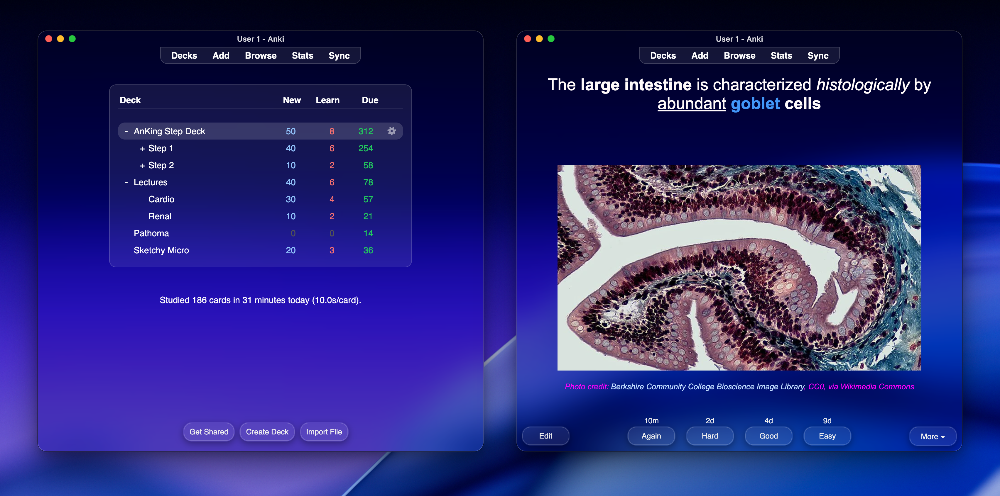

# AnkiGlass

Native macOS **Liquid Glass** for [Anki](https://apps.ankiweb.net/). AnkiGlass
gives Anki's main window a real AppKit `NSGlassEffectView` — the macOS 26
"Tahoe" glass material — behind the deck list, deck overview, and reviewer,
with frosted toolbar and bottom-bar controls and a theme-aware tint.

> macOS only. Best on macOS 26 (Tahoe) for true Liquid Glass; older macOS gets
> a vibrancy (frosted) fallback. On Windows and Linux the add-on does nothing.

## Screenshots

## Install

- **From AnkiWeb:** in Tools → Add-ons → Get Add-ons, paste the code
  `1866406123`. It needs Anki 24.04 or newer. See the
  [AnkiWeb page](https://ankiweb.net/shared/info/1866406123).
- **From a build:** run `./build.sh` and double-click `dist/anki-glass.ankiaddon`,
  or in Anki use Tools → Add-ons → Install from file.

Restart Anki after installing.

## Configuration

Tools → AnkiGlass Options... opens its Settings (so does Tools → Add-ons →
AnkiGlass → Config). See
[`src/config.md`](src/config.md) for each option. In short: choose which
screens get glass, whether the card area itself is glass, whether AnkiGlass's
sibling add-ons' windows get glass too, and the tint colour for light and dark
mode. To switch it off, turn AnkiGlass off in Tools →
Add-ons, like any add-on.

## How it works

Anki's UI is Qt/Chromium web views, not native AppKit controls, so AnkiGlass
does not replace the widget engine. Instead it:

1. Makes the main `NSWindow` transparent and requests an alpha surface format so
   Chromium clears its transparent regions cleanly (no ghosting).
2. Hosts a real `NSGlassEffectView` in a **borderless child window pinned behind**
   the main window. The main window is never re-parented, so Qt keeps ownership
   of its own view and mouse hover (e.g. AMBOSS pop-ups) keeps working.
3. Injects small, scoped CSS into Anki's toolbar, bottom bar, and card pages to
   make their backgrounds transparent and style the controls as frosted glass.

The windows of its sibling add-ons ([Stepwise](https://github.com/AIbrahimv2/AnkiStepwise),
[Skim](https://github.com/AIbrahimv2/AnkiSkim),
[Exam Timeline](https://github.com/AIbrahimv2/AnkiExamTimeline), and the
Settings, What's new and About window they share) ask for the same glass
through their shared kit (`kit.glass(window)`); `src/windows.py` puts it
behind each one, and the kit's theme makes their pages see-through.

It talks to the Objective-C runtime through `ctypes` (see `objc_bridge.py`) —
the same technique Anki itself uses for its bundled macOS helper — because Anki
does not ship PyObjC.

## Caveats

- macOS 26 (Tahoe) is required for genuine Liquid Glass; earlier macOS shows a
  vibrancy fallback.
- Tiling window managers may try to manage the child glass window; if the glass
  detaches on move/resize, that is the window manager, not Anki.
- Some heavily customised note types paint their own full-card background;
  AnkiGlass neutralises canvas-sized backgrounds automatically, but very unusual
  templates may need `glass_card` set to `false`.

## Development

- Source lives in `src/`. Symlink or copy it into your Anki add-ons folder as
  `anki_glass` to test, then restart Anki.
- `./build.sh` packages `src/` into `dist/anki-glass.ankiaddon`.
- `python3 tools/screenshots.py` renders `docs/screenshot.png` and
  `docs/review.png` (used here and on AnkiWeb) with the add-ons' shared
  screenshot tools in the kit (`../anki-addon-kit/screenshots`): Anki's own
  pages with this add-on's CSS, on macOS Tahoe's dark wallpaper. The card
  under review is a real AnKing card with a CC0 image, rendered
  from a copy of your collection.

## License

[AGPL-3.0](LICENSE).
