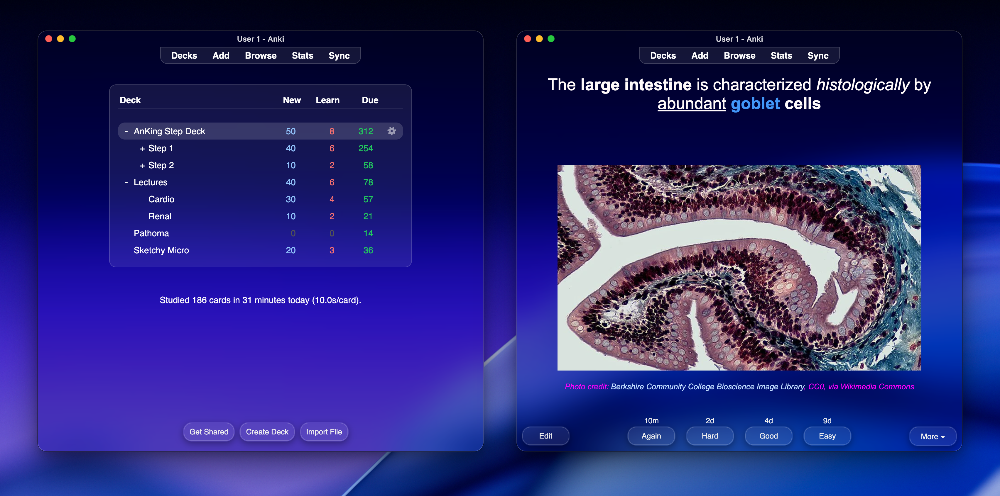

# AnkiWeb listing

What's in the AnkiWeb add-on form (https://ankiweb.net/shared/upload?id=1866406123).
Keep this in step with the live listing; the release steps are in the
`anki-addon-release` skill (see CLAUDE.md).

## Package on AnkiWeb

Version 1.2.0, uploaded 2026-11-17. The release script (`release.py --uploaded`
in the `anki-addon-release` skill) updates this line after each upload.

## Title

🫧 AnkiGlass: native macOS Liquid Glass for Anki

## Tags

liquid glass macos tahoe theme transparent transparency translucent blur frosted glass vibrancy aesthetic beautify skin ui appearance mac apple

## Search

Searched on 2026-11-15, before and after the tags above replaced the old
ones, with the `ankiweb_search.py` approach from the `anki-addon-release`
skill. "Results" is how many add-ons match now. AnkiWeb sorts results by
ratings, so an add-on without ratings comes after every rated match; the
words only decide whether it shows up.

- Tags match whole words. "study plan" didn't find the tag "study planner",
  while the title and description match parts of words ("mac" finds
  "macOS"). So the tags spell out the exact words people type.
- Neighbouring tags read as a phrase, so their order matters.
- Left out on purpose: "dark mode" (AnkiGlass isn't a dark theme; the
  description already mentions light and dark mode), and "acrylic" or
  "mica", Windows' words for it.

| Search | Results | Before | After |
| --- | --- | --- | --- |
| glass | 44 | #12 | #12 |
| liquid glass | 5 | #3 | #3 |
| frosted | 14 | #5 | #3 |
| transparent | 57 | absent | #28 |
| transparency | 23 | absent | #11 |
| translucent | 12 | absent | #6 |
| blur | 36 | absent | #21 |
| vibrancy | 1 | absent | #1 |
| tahoe | 7 | #7 | #7 |
| theme | 359 | #238 | #216 |
| aesthetic | 29 | absent | #17 |
| beautify | 10 | absent | #8 |
| skin | 63 | absent | #37 |
| appearance | 74 | #50 | #43 |
| background | 349 | #200 | #188 |
| macos | 371 | #185 | #162 |
| apple | 76 | #41 | #40 |

## Support page

https://github.com/AIbrahimv2/AnkiGlass/issues

## Supported Anki versions

Minimum 24.04, maximum 26.09.4 with no `-`, so newer versions get it too. The
form turns 24.04 into "24.04.0", and the listing shows "24.04-26.09.4+".

Anki says the code is invalid to anyone below the minimum. Until 2026-11-14
both were 26.09.4, the version installed at the time, so only 26.09.4 and
newer could install it. Checked after the change with
`curl -s -o /dev/null --max-filesize 1 -w '%{http_code}' "https://ankiweb.net/shared/download/1866406123?v=2.1&p=<point version>"`:
404 for 2.1.66, 23.10 and 23.12.1 (p=66, 231000, 231201), and 303 (a
download) for 24.04 to 26.10 (240400 up).

Why 24.04:

- What AnkiGlass needs from Anki is old: `webview_will_set_content`, the
  reviewer, deck browser, overview and state hooks, `mw.toolbarWeb`,
  `mw.bottomWeb` and `mw.web`, and the toolbar and bottom bar markup it
  styles (`.fancy .toolbar`, `.hitem`, `#outer`, `--border-radius-large`).
  From Qt it needs only a translucent main window and clear web page
  backgrounds. From macOS, `NSGlassEffectView` (macOS 26), or
  `NSVisualEffectView` on older macOS. None of that ties it to a recent Anki.
- The Settings, What's new and About window (the shared kit, from the release
  after 1.1.0) is a web page whose stylesheet uses `color-mix()`, which needs
  Chromium 111. 24.04 is the first release whose builds all ship Qt 6.6
  (Chromium 112); 2.1.66 and 23.12 on Mac have Qt 6.5 (Chromium 108).
- Up to 25.02, Anki runs add-ons on Python 3.9. AnkiGlass works there.

Tested on 2026-11-14 with `tools/version_probe.py`, which opens a real Anki
window on an empty profile with a copy of the add-on and checks, from inside
Anki: the glass window behind the main window and matching its frame, the
clear page backgrounds and glass CSS on the deck list, the overview, a review
(question and answer), the Settings window, and full screen and back. All 68
checks pass on 24.04 and 25.02.7 (Python 3.9, Qt 6.6), 25.07.5 and 25.09.4
(Python 3.13, Qt 6.9), and 26.09.4 (Qt 6.11). The 1.1.0 code, which is what
AnkiWeb serves, passes its 66 (it has no Settings window) on 24.04.

Not tested: macOS before 26 (the `NSVisualEffectView` fallback; this Mac runs
macOS 27), Intel Macs (`objc_bridge.py` assumes arm64), and the launcher's
optional Qt 6.7 and 6.8 builds. In full screen the window reports itself as
see-through again on every Qt tested, but its background is solid, so it
looks normal.

## Description

Paste as is. AnkiWeb takes Markdown and basic HTML. It follows the layout in
the `anki-addon-release` skill's listing conventions: what it does, the code
line and the screenshot first, the signature last.

```markdown
Give Anki's main window Apple's Liquid Glass look on your Mac. The deck list, a deck's overview and the review screen get a frosted, see-through background that softly shows your desktop and other windows behind Anki, with the toolbar and the buttons at the bottom in matching glass.

**Code: 1866406123.** Paste it in Anki under **Tools → Add-ons → Get Add-ons**. Needs Anki 24.04 or newer, on a Mac.

<p></p>

<p></p>

**Features**

- Real Liquid Glass on macOS 26 (Tahoe). Older versions of macOS get a similar frosted look.
- Works in light and dark mode, with a tint behind the text that you can adjust.
- Hovering and pop-ups (like AMBOSS) work as usual.
- In full screen, Anki keeps its normal look, since there's nothing behind the window to see through. The glass comes back when you leave full screen.

**Settings:** Tools → Add-ons → AnkiGlass → Config. Choose which screens get glass, whether the card itself is glass, and the tint for light and dark mode. Changes apply after restarting Anki. To switch it off, turn it off in Tools → Add-ons.

**Good to know**

- Mac only. On Windows and Linux it does nothing.
- If you use a tiling window manager, it may try to arrange the glass behind Anki. If it does, exclude Anki in the manager's settings.

Source, changelog and issues: [github.com/AIbrahimv2/AnkiGlass](https://github.com/AIbrahimv2/AnkiGlass)

<p><a href="https://abdelrahmanibrahim.com/anki/"></a></p>
```
